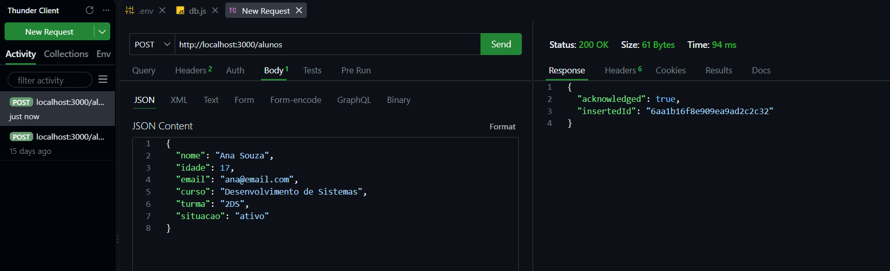
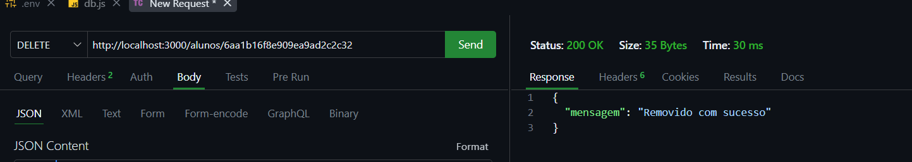
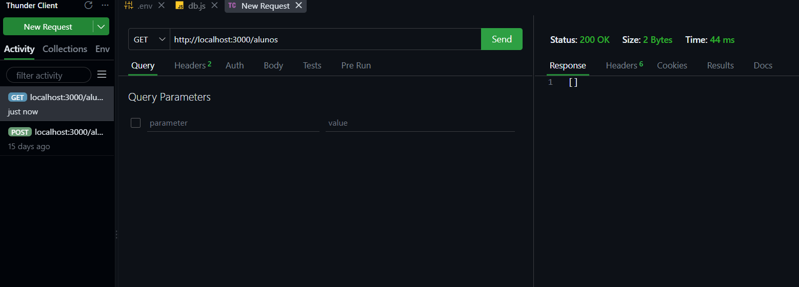

# API de Gestão Escolar

API REST para consultar e gerenciar alunos, desenvolvida com Node.js, Express e MongoDB.

## Funcionalidades

- Listar alunos cadastrados.
- Cadastrar um aluno.
- Consultar e atualizar um aluno pelo ID.
- Remover um aluno pelo ID.

## Tecnologias

- [Node.js](https://nodejs.org/)
- [Express](https://expressjs.com/)
- [MongoDB](https://www.mongodb.com/)
- [Jest](https://jestjs.io/) e [Supertest](https://github.com/ladjs/supertest) para testes automatizados.

## Requisitos

- Node.js e npm instalados.
- Uma instância do MongoDB acessível pela aplicação.

## Como executar

1. Instale as dependências:

   ```bash
   npm install
   ```

2. Crie um arquivo `.env` na raiz do projeto e configure a conexão com o MongoDB:

   ```env
   MONGO_URI=mongodb://localhost:27017
   ```

   A aplicação usa o banco `gestao_escolar` e a coleção `alunos`.

3. Inicie a API:

   ```bash
   npm start
   ```

Por padrão, a API fica disponível em `http://localhost:3000`. Para alterar a porta, defina a variável `PORT`.

## Rotas

Todas as rotas usam o prefixo `/alunos`.

| Método | Rota | Descrição |
| --- | --- | --- |
| `GET` | `/alunos` | Retorna a lista de alunos. |
| `POST` | `/alunos` | Cadastra um aluno. |
| `GET` | `/alunos/:id` | Busca um aluno pelo ID. |
| `PUT` | `/alunos/:id` | Atualiza os campos informados para o aluno. |
| `DELETE` | `/alunos/:id` | Remove um aluno pelo ID. |

### Exemplos

Cadastrar um aluno:

```http
POST /alunos
Content-Type: application/json
```

```json
{
  "nome": "Maria",
  "idade": 15
}
```

A API acrescenta `situacao: "ativo"` e `dataCadastro` ao documento enviado e retorna o resultado da inserção do MongoDB.

Atualizar um aluno:

```http
PUT /alunos/507f1f77bcf86cd799439011
Content-Type: application/json
```

```json
{
  "idade": 16
}
```

### Respostas de erro

Nas operações por ID, um formato inválido retorna HTTP `400` com `{"erro":"ID inválido"}`. Se o ID for válido, mas não corresponder a um aluno, a API retorna HTTP `404` com `{"erro":"Aluno não encontrado"}`.

## Testes

Execute a suíte automatizada com:

```bash
npm test
```

Os testes cobrem a listagem, o cadastro com dados válidos, o tratamento de JSON inválido, a remoção de um aluno existente e os casos de aluno inexistente ou ID inválido. O acesso ao MongoDB é simulado com `jest.mock`, portanto não é necessário iniciar um banco para executar os testes. A suíte usa Jest e Supertest.

## Estrutura do projeto

```text
.
├── src/
│   ├── routes/
│   │   └── alunos.js
│   ├── app.js
│   └── db.js
├── tests/
│   └── alunos.test.js
├── imagens/
├── .env
├── package.json
└── README.md
```

## Imagens

Capturas de tela do banco de dados e de exemplos de requisições:

| Banco de dados | Cadastro (`POST`) |
| --- | --- |
|  |  |

| Remoção (`DELETE`) | Consultas (`GET`) |
| --- | --- |
|  |  |

Outras capturas de consultas e da lista após a remoção:

- [GET após o cadastro](imagens/GET2dd.png)
- [Lista após a remoção](imagens/GET3ld.png)
- [Lista de alunos após a remoção](imagens/listaDepoisDoDelet.png)
